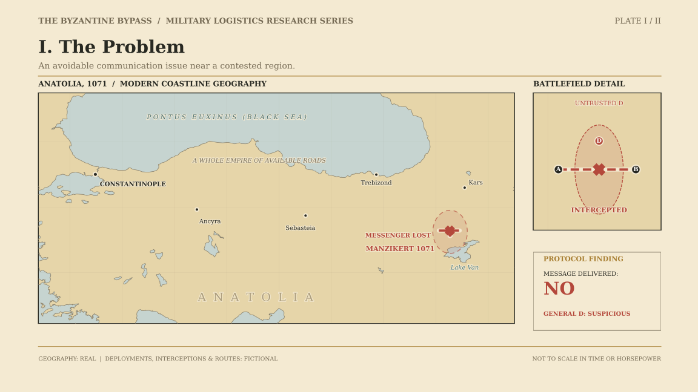
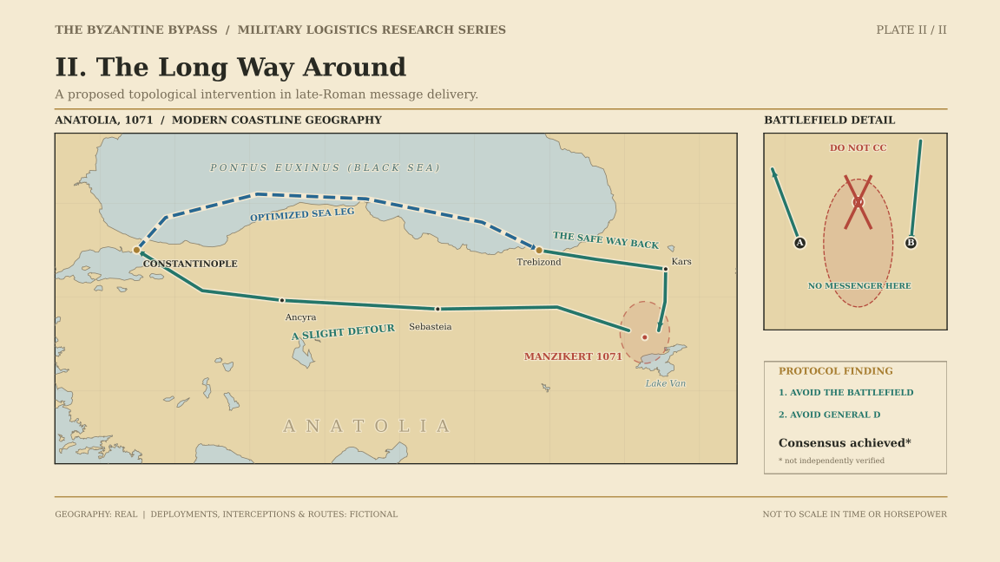

<h1 align="center">Byzantine Bypass</h1>

<p align="center">
  <em>Why tolerate Byzantine faults when you can simply go around them?</em>
</p>

<p align="center">
  <strong>A novel, geography-first approach to distributed consensus.</strong><br>
  <sub>Military Logistics Research Series &nbsp;·&nbsp; Plates I–II &nbsp;·&nbsp; Not peer reviewed</sub>
</p>

<p align="center">
  <a href="#i-the-problem">The problem</a> &nbsp;·&nbsp;
  <a href="#ii-the-breakthrough">The breakthrough</a> &nbsp;·&nbsp;
  <a href="#iii-reference-implementation">Implementation</a> &nbsp;·&nbsp;
  <a href="#iv-correctness-argument">Proof</a> &nbsp;·&nbsp;
  <a href="#vi-known-limitations">Limitations</a>
</p>

---

The Byzantine Generals Problem asks how a group of distributed participants can agree on a decision when some of them may lie, fail, or send conflicting information. Its well-known military metaphor has generals coordinate an attack by sending messengers between isolated camps.

Going through the consensus literature, we identified two operational issues that have received conspicuously little attention:

1. The messenger might be intercepted.
2. One of the generals might be **that weirdo**.

Both admit surprisingly straightforward solutions.

## I. The problem

Assume two Byzantine commanders, Generals A and B, who are trying to coordinate their next move near **Manzikert** in eastern Anatolia. General A sends an order, the messenger takes the shortest route, and he is intercepted in the contested area; as a consequence, the order never arrives.

<p align="center">
  
  <br>
  <sub><strong>Figure 1.</strong> The conventional approach: send a messenger directly through a war zone, then act surprised when he doesn't arrive.</sub>
</p>

General B keeps waiting; General D, meanwhile, behaves strangely and has begun telling everyone contradictory things.

Existing approaches to fault tolerance tend to focus on difficult questions such as authentication, quorum formation, equivocation, and agreement, so far without satisfactory answers. We ask a simpler question instead: **What if the messenger took a different road?**

## II. The breakthrough

We present the **Long Way Around Protocol (LWAP)**, which consists of two independent advances:

<p align="center">
  
  <br>
  <sub><strong>Figure 2.</strong> The proposed protocol: send the messenger to Constantinople, charter passage across the Black Sea to Trebizond, then approach General B from the north. Do not CC General D.</sub>
</p>

### 1. Geographic Byzantine Fault Avoidance (GBFA)

* If the shortest route runs through a war zone, do not use that route.
* Instead, travel halfway across the empire: visit **Constantinople**, cross the **Black Sea**, stop over in **Trebizond**, and approach from another direction.
* The key property is that a messenger cannot be intercepted at the original ambush site while he is nowhere near it.

### 2. Suspicious General Exclusion (SGE)

If one of the generals is a traitor, we propose the following improvement to membership management:

* **Stop talking to him.**
* Specifically, remove General D from the distribution list. He is clearly a weirdo and was making everyone uncomfortable anyway.
* As a practical matter, the technique assumes that a reliable, universally agreed-upon list of traitors is already available. We consider producing that list an implementation detail.

## III. Reference implementation

```rust
use byzantine_bypass::{General, plan_dispatch};

let generals = [
    General::new("General A", false),
    General::new("General B", false),
    General::new("General D (that weirdo)", true),
];

let plan = plan_dispatch(&generals);

assert!(!plan.recipients.contains(&"General D (that weirdo)"));
assert!(plan.waypoints.contains(&"Constantinople"));

// Byzantine fault: solved. Probably.
```

The library implements a dispatch plan rather than an actual consensus protocol. This is intentional and, in our view, a refreshing reduction in complexity.

## IV. Correctness argument

**Lemma 1 — Ambush avoidance.** A messenger who does not travel through the original ambush location cannot be intercepted *at that location*.

**Lemma 2 — The weirdo principle.** A general who is not on the distribution list receives no messages *from that distribution list*.

> **Theorem — Byzantine tolerance.** From Lemmas 1 and 2, our protocol solves the Byzantine Generals Problem, provided the only ambush is the known ambush, the excluded general is the only traitor, all other routes are safe, all remaining generals agree on the exclusion, and message delivery is otherwise reliable.
>
> *Proof.* The troublesome assumptions have been relocated from the protocol to the environment. □

All of the above is machine-checked in Coq ([`proofs/LWAP.v`](proofs/LWAP.v)), and `Print Assumptions byzantine_tolerance` reports no axioms whatsoever. The hypotheses aren't axioms either; they are, as is tradition, left to the reader.

## V. Evaluation

| Metric | Conventional approach | Byzantine Bypass |
|---|---|---|
| Crossings of the original ambush site | 1 | 0 |
| Messages addressed to General D | Potentially many | 0 |
| Scenic views | Limited | Excellent |
| Horse replacement opportunities | Few | Abundant |
| Maritime dependencies | None | At least one |
| Guarantees of Byzantine agreement | Requires actual protocol | Not included |

The maps are **schematic and intentionally fictional**. Their base geography follows modern coastlines and the real locations of Manzikert, Constantinople, and Trebizond, while the generals' positions, the intercepted messenger, and the itinerary are invented for the joke; they are **not** a reconstruction of the historical Battle of Manzikert (1071).

## VI. Known limitations

- It does not help if the recipient is the traitor.
- It does not establish which general is the traitor.
- A second ambush can be established on the scenic route.
- Intermediary cities and ships may also contain weirdos.
- All honest generals still need to agree on the same outcome.
- It dramatically increases latency.
- It does not solve Byzantine consensus, despite what the repository name might suggest.

For readers who have made it this far: lost messengers illustrate unreliable communication, which is the subject of the closely related **Two Generals' Problem**. The classical **Byzantine Generals Problem**, in turn, is about arbitrary or malicious behavior, such as participants telling different stories to different peers. Routing around an intercepted messenger can improve delivery in some circumstances, but it cannot guarantee Byzantine agreement. Likewise, excluding a *known* malicious participant is straightforward; identifying them, and getting everyone to agree on the membership, is the real work.

## VII. Future work

We plan to investigate authenticated saddlebags, redundant horses, a trusted monastery relay, confidence-weighted gossip about weirdos, and pigeon-based asynchronous transport.

## Sources and acknowledgments

- Lamport, Shostak, and Pease, [*The Byzantine Generals Problem*](https://www.sri.com/publication/information-computer-science-pubs/the-byzantine-generals-problem/) (1982).
- [Manzikert](https://academic.oup.com/reference/62399/reference-article-abstract/561732157), the historical battle of 26 August 1071. The joke makes *no* claim that any such message interception or coordination protocol took place there.
- Map geography from GSHHS coastline data, rendered with Matplotlib/Basemap. Maps use the same view and base layer, with different annotations. Regenerate with `uv run tools/render_maps.py`.

## License

MIT. Military advice not included.
